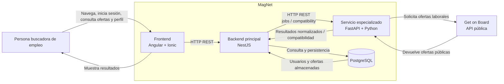

# Diagrama de contenedores — MagNet

## Propósito

Este diagrama representa los principales contenedores y componentes de MagNet, sus responsabilidades y las comunicaciones entre ellos.



## Contenedores y responsabilidades

### Frontend — Angular + Ionic

Responsable de la interfaz de usuario y navegación de MagNet.

Funciones actuales y previstas:

- registro e inicio de sesión;
- visualización del perfil;
- consulta de ofertas laborales;
- navegación hacia la oferta original;
- visualización futura de compatibilidad laboral.

El frontend se comunica únicamente con NestJS y no debe acceder directamente a FastAPI ni a PostgreSQL.

### Backend principal — NestJS

Es la API principal del sistema y concentra la lógica de negocio.

Responsabilidades principales:

- autenticación y autorización;
- gestión de usuarios;
- exposición de endpoints REST;
- persistencia de información;
- consulta de ofertas almacenadas;
- coordinación con FastAPI;
- manejo de errores y respuestas hacia el frontend.

### Servicio especializado — FastAPI + Python

Es el servicio especializado para procesamiento de información.

Responsabilidades principales:

- recuperar ofertas desde Get on Board;
- limpiar y normalizar datos;
- deduplicar información durante la recuperación;
- exponer endpoints para procesamiento especializado;
- calcular compatibilidad laboral en la evolución del sistema.

FastAPI no actúa como API pública principal para el frontend.

### PostgreSQL

Base de datos relacional utilizada por NestJS.

Actualmente almacena:

- usuarios;
- ofertas laborales;
- información de procedencia;
- timestamps;
- restricciones e índices para evitar duplicados.

La persistencia principal es administrada desde NestJS mediante TypeORM.

### Get on Board

Fuente externa inicial de ofertas laborales reales.

FastAPI consulta su API pública, transforma los datos obtenidos y los devuelve a NestJS para su posterior persistencia y exposición al frontend.

## Flujos principales

### Consulta de ofertas almacenadas

```text
Usuario
  ↓
Angular/Ionic
  ↓
NestJS
  ↓
PostgreSQL
  ↓
NestJS
  ↓
Angular/Ionic
```

### Recuperación e importación de ofertas

```text
NestJS
  ↓
FastAPI
  ↓
Get on Board
  ↓
FastAPI
  ↓
NestJS
  ↓
PostgreSQL
```

### Compatibilidad laboral

```text
Angular/Ionic
  ↓
NestJS
  ↓
FastAPI
  ↓
NestJS
  ↓
Angular/Ionic
```

## Restricciones arquitectónicas relevantes

- Angular/Ionic solo debe comunicarse con NestJS.
- FastAPI cumple una función especializada y no reemplaza a NestJS como API principal.
- PostgreSQL es administrado desde NestJS mediante TypeORM.
- Las ofertas externas conservan información de procedencia y enlace original.
- La fuente externa actual es Get on Board.