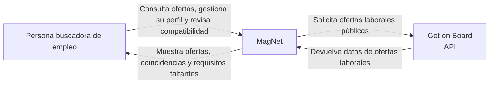

# Diagrama de contexto — MagNet

## Propósito

Este diagrama representa el contexto general de MagNet, identificando al usuario principal, el sistema MagNet y la fuente externa de ofertas laborales utilizada actualmente.

## Actores y sistemas externos

### Persona buscadora de empleo

Es el usuario principal de MagNet. Utiliza la aplicación para consultar oportunidades laborales, gestionar su información de perfil y revisar ofertas que puedan ser compatibles con sus características, intereses y experiencia.

### MagNet

Es el sistema desarrollado para recuperar, procesar, almacenar y presentar ofertas laborales reales.

MagNet también contempla una capacidad adaptativa orientada a calcular un índice explicable de compatibilidad entre el perfil del usuario y los requisitos de una oferta.

### Get on Board

Es la fuente externa inicial utilizada por MagNet para recuperar ofertas laborales reales mediante su API pública.

MagNet conserva la procedencia de las ofertas y redirige al usuario hacia la publicación original cuando desea consultar más información o postular.

## Alcance del diagrama

Este diagrama representa únicamente el contexto externo del sistema.

La arquitectura interna de MagNet, incluyendo Angular/Ionic, NestJS, FastAPI y PostgreSQL, se documenta por separado en el diagrama de contenedores/componentes correspondiente a ARCH-002.