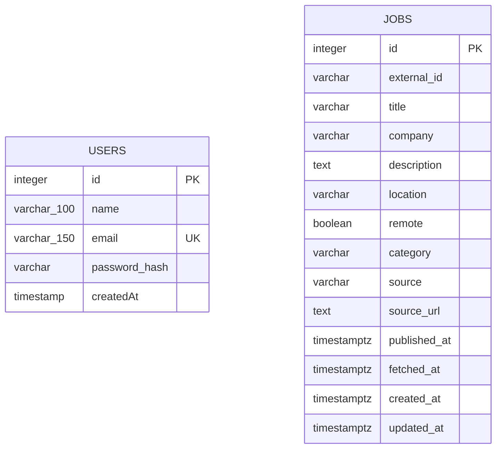

# Modelo de datos — MagNet

## Propósito

Este documento representa el modelo de datos actualmente implementado en PostgreSQL para MagNet.

El esquema actual contiene dos entidades principales:

- `users`: usuarios registrados en la aplicación.
- `jobs`: ofertas laborales recuperadas desde una fuente externa y persistidas por NestJS.

Actualmente no existe una clave foránea directa entre `users` y `jobs`.

## Diagrama entidad-relación



> El esquema actual no define una relación mediante clave foránea entre `users` y `jobs`.

## Tabla `users`

Almacena la información básica necesaria para registro y autenticación.

| Columna | Tipo | Restricción | Descripción |
|---|---|---|---|
| `id` | integer | PK, NOT NULL | Identificador interno autogenerado |
| `name` | varchar(100) | NOT NULL | Nombre del usuario |
| `email` | varchar(150) | UNIQUE, NOT NULL | Correo utilizado para identificación |
| `password_hash` | varchar | NOT NULL | Hash de contraseña; no almacena contraseña en texto plano |
| `createdAt` | timestamp | NOT NULL, default `now()` | Fecha de creación del usuario |

### Índices y restricciones

- Primary key: `id`.
- Restricción única sobre `email`.

## Tabla `jobs`

Almacena ofertas laborales recuperadas desde fuentes externas.

| Columna | Tipo | Restricción | Descripción |
|---|---|---|---|
| `id` | integer | PK, NOT NULL | Identificador interno autogenerado |
| `external_id` | varchar | NOT NULL | Identificador de la oferta en la fuente externa |
| `title` | varchar | NOT NULL | Cargo de la oferta |
| `company` | varchar | NOT NULL | Empresa asociada |
| `description` | text | NOT NULL | Descripción/requisitos normalizados |
| `location` | varchar | NULL | Ubicación informada |
| `remote` | boolean | NULL | Indica modalidad remota cuando está disponible |
| `category` | varchar | NULL | Categoría de la oferta |
| `source` | varchar | NOT NULL | Fuente de procedencia |
| `source_url` | text | NOT NULL | URL de la publicación original |
| `published_at` | timestamptz | NULL | Fecha de publicación en la fuente |
| `fetched_at` | timestamptz | NOT NULL | Fecha de recuperación por MagNet |
| `created_at` | timestamptz | NOT NULL, default `now()` | Fecha de creación del registro |
| `updated_at` | timestamptz | NOT NULL, default `now()` | Fecha de última actualización |

### Índices y restricciones

- Primary key: `id`.
- Índice único compuesto sobre:

```text
(source, external_id)
```

Esta restricción evita almacenar dos veces una misma oferta proveniente de la misma fuente.

## Trazabilidad y procedencia

La tabla `jobs` conserva información que permite identificar el origen y la fecha de recuperación de cada oferta:

- `source`: identifica la fuente externa.
- `external_id`: identifica la oferta dentro de esa fuente.
- `source_url`: permite acceder a la publicación original.
- `published_at`: conserva la fecha de publicación cuando está disponible.
- `fetched_at`: registra cuándo MagNet recuperó la oferta.

Actualmente la fuente utilizada es Get on Board.

## Persistencia

La persistencia principal es administrada por NestJS mediante TypeORM.

Los cambios de estructura se gestionan mediante migraciones y no mediante `synchronize: true`.

## Evolución prevista

En fases posteriores el modelo podrá incorporar entidades relacionadas con:

- perfil laboral del usuario;
- habilidades;
- preferencias;
- resultados de compatibilidad;
- historial o favoritos.

Estas entidades no forman parte del esquema implementado actualmente y por ello no se incluyen en el DER actual.